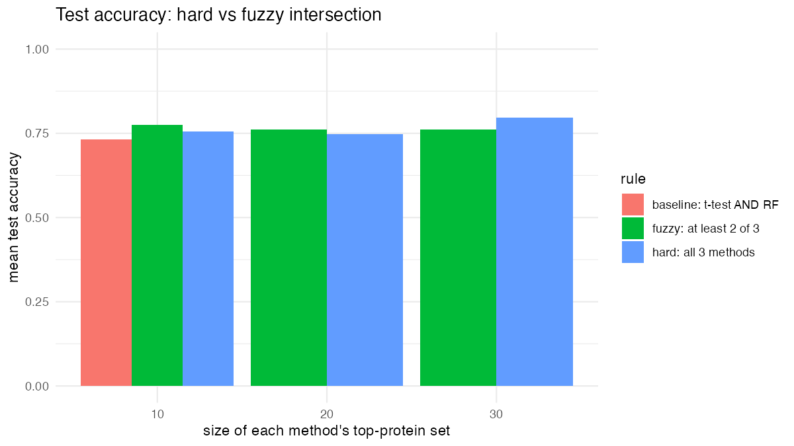

```{r}
library(tidyverse)
```

## Abstract

Early detection of autism spectrum disorder (ASD) from blood-based biomarkers has been suggested using serum protein levels as a published study reports a logistic regression classifier built on a small protein panel. We reanalyzed the data from this study with new variations and examined how methodological choices affect results. First, we showed how the log10 transform reduces skewness (median 2.26 to 0.83) and that outlying values are concentrated in a small number of subjects. We then showed that selecting proteins using the training set gives a test AUC of 0.812 compared with the baseline of 0.883, suggesting that the study's approach is optimistic. Increasing the number of proteins selected per method and replacing the hard intersection with a fuzzy “2 of 3 methods” rule changed panel size more than accuracy. Last, a LASSO selected five protein panel had an AUC of 0.933 on the test set. With 31–32 test subjects, we do not claim that any of the variations clearly improves on the baseline.

## Dataset

Data was obtained from serum samples from 76 boys with ASD and 78 typically developing (TD) boys, 18 months - 8 years of age. Participants were not randomly selected, instead enrolled based on specific clinical screening criteria. Participants with genetic, metabolic, or other concurrent physical, mental, or neurological disorders were excluded. TD subjects were excluded if they had any first- or second-degree relatives diagnosed with ASD.

1317 proteins were measured, with 192 of them failing quality control of the original study. Because the ones that failed quality control are unknown, we will be using all of them. Protein abundance data was normalized by taking log10 transform and then z-transformation. To deal with outliers, any values after transformation above 3 or below -3 were clipped to those values.

## Summary of published analysis

After data collection and preprocessing, researchers combined 3 feature selection techniques.

1\. A random forest model was trained 1000 times. Each protein's importance was averaged over those runs, using MeanDecreaseGini (mean decrease in Gini Index). The 10 proteins with the highest averaged importance values were chosen from this method.

2\. T-tests with FDR \< 0.05 were conducted to find which proteins indicate a significant difference. The 10 proteins with the most highly significant t-test values were selected.

3\. A correlation approach was used to calculate each protein’s correlation with ADOS total scores (a measure of ASD severity). The 10 most highly correlated proteins were selected.

After finding the top 10 proteins from each method, they found 5 proteins that were in each method's top 10. Those were selected as the 5 proteins for the baseline model, leaving the other 13 proteins for investigation. They then trained a logistic regression model using an 80-20 train-test split, using AUC as the evaluation metric. This process was repeated 1000 times to suppress bias.

The 5 core proteins were MAPK14, IgD, DERM, EPHB2, and suPAR. 4 other proteins were added that raised the AUC: ROR1, GI24, elF-4H, and ARSB. Combining the 5 core proteins with the additional 4 proteins resulted in an AUC = 0.860±0.064, with a sensitivity = 0.833±0.118, and specificity = 0.846±0.118.

```{mermaid}
%%| label: fig-methods
%%| fig-cap: "Methodological design of the ASD protein classifier"
flowchart TD
    A[Data collection and preprocessing] --> B[Random forest x1000<br/>mean MeanDecreaseGini<br/>top 10 proteins]
    A --> C[t-tests, FDR < 0.05<br/>top 10 proteins]
    A --> D[Correlation with ADOS total score<br/>top 10 proteins]
    B --> E{Overlap of the three top-10 lists}
    C --> E
    D --> E
    E --> F[5 core proteins<br/>MAPK14, IgD, DERM, EPHB2, suPAR]
    E --> G[13 remaining proteins<br/>for further investigation]
    F --> H[Baseline logistic regression<br/>80/20 train-test split<br/>repeated 1000 times, AUC]
    G --> I[Add candidate proteins<br/>ROR1, GI24, eIF-4H, ARSB]
    H --> I
     I[Add each of the 13 proteins to the core, one at a time,<br/>keeping those that raise AUC] --> J[4 additive proteins<br/>ROR1, GI24, eIF-4H, ARSB]
   J --> K[Final 9-protein panel<br/>AUC 0.860 ± 0.064<br/>Sens 0.833 ± 0.118<br/>Spec 0.846 ± 0.118]
```

## Findings

### Impact of preprocessing and outliers

**Why log-transform?** Raw protein levels are strictly positive (minimum 12.9) and mostly right-skewed, with a few very large values (@fig-log). The median skewness across all 1,317 proteins is 2.26 on the raw scale and 0.83 after log10, and the share of proteins with skewness above 1 falls from 76% to 45%. Raw levels also have a spread that grows with the mean: the correlation between a protein's mean and its SD is 0.78 raw but 0.10 after log10. The log transform therefore pulls in the long right tail and puts proteins on a comparable scale, which better fits the roughly symmetric, equal-variance behavior that the t-tests assume and keeps a few extreme raw values from dominating means and SDs. The transform does not fully symmetrize every protein, since 45% still have skewness above 1. Ω¢

::: {#fig-log layout-ncol="2"}


Distributions of nine randomly sampled proteins before and after the log10 transform.
:::

**Outliers.** We removed the trimming step and defined an outlying value as a standardized value beyond ±3, the same cutoff used for trimming. This flags 2,379 of 202,818 values (1.2%), 83% of them on the high side. Under normality we would expect about 3.6 outlying values per subject; the median subject has 8.5. Outliers are concentrated in a few subjects rather than in particular proteins (no protein has more than 7 outlying values). Thirteen subjects exceed the Tukey upper fence on per-subject counts (about 29 outlying values) and together accoxunt for 46% of all outlying values (@fig-outliers). The most extreme are subjects 154 (157 outlying values), 108 (127), 9 (126), 121 (122), and 52 (121). Several of these have outliers almost entirely in one direction (subject 9 has 126 high and none low), which suggests a sample-level shift rather than protein-specific effects; we did not test this.

{#fig-outliers}

| Group | Subjects | Total outlying values | Mean per subject | Median per subject | Flagged subjects |
|------------|------------|------------|------------|------------|------------|
| ASD | 76 | 1,007 | 13.2 | 8.5 | 4 |
| TD | 78 | 1,372 | 17.6 | 8.5 | 9 |

: Outlying values by group.

TD subjects have more outlying values in raw counts (@tbl-outliers), but the medians are identical and the difference comes from a handful of extreme subjects. We found no statistical evidence that one group is more outlier-prone: the Wilcoxon rank-sum test on per-subject counts gives p = 0.82, a permutation test on mean counts gives p = 0.29, and a Fisher exact test on flagged subjects gives p = 0.25. Trimming at ±3 caps these values rather than removing the subjects, so the flagged subjects still contribute many capped values to every downstream analysis.

### Methodological variations

#### Preventing Data Leakage

**Methodology**

In the original in-class analysis, feature selection using t-tests and Random Forest importance was performed on the full dataset before the train-test split. This could introduce data leakage because information from the test set was used during feature selection, potentially leading to overly optimistic performance estimates.

To address this issue, we used an 80/20 train-test split, with 122 samples in the training set and 32 in the testing set. All feature selection steps were performed using the training set only. First, we conducted t-tests with multiple-testing correction and selected the top 10 proteins. Next, we fitted a Random Forest model with 1,000 trees and selected another 10 proteins based on MeanDecreaseGini importance. We then identified the intersection of these two sets, resulting in three proteins: DERM, IgD, and TrkC.

A logistic regression model was fitted using these three proteins on the training set and evaluated on the held-out test set.

**Results**

The model achieved the following results on the held-out test set:

| Metric      | Training-only feature selection |
|:------------|--------------------------------:|
| ROC AUC     |                           0.812 |
| Accuracy    |                           0.750 |
| Sensitivity |                           0.812 |
| Specificity |                           0.688 |

The test set contained 32 samples, including 16 ASD and 16 TD samples. The model correctly classified 24 out of 32 samples, including 13 of the 16 ASD samples and 11 of the 16 TD samples.

**Comparison with the in-class baseline**

The in-class baseline achieved an ROC AUC of 0.883, an accuracy of 0.774, a sensitivity of 0.812, and a specificity of 0.733. Compared with the baseline, our model had a lower ROC AUC and accuracy, the same sensitivity, and a lower specificity.

However, the two results should be compared with caution. The in-class analysis performed feature selection on the full dataset, including the test samples, which could lead to overly optimistic performance estimates. Our analysis used only the training data for feature selection, reducing this risk. The test sets also differed in size, so the performance difference cannot be attributed to feature selection alone.

**Limitations**

The test set was relatively small, so the performance estimates may be uncertain. Further validation using independent datasets and repeated train-test splits would help assess the stability of the results. Although the model showed some ability to distinguish ASD from TD samples, these findings do not establish its clinical usefulness for early ASD detection.

#### Increasing the number of selected proteins

We investigated whether increasing the number of proteins selected by each feature-selection method would improve classification performance. Instead of selecting the top 10 proteins from each method, we selected the top 20 using t-test significance and random forest importance. We then took the intersection of the two lists and trained a logistic regression classifier.

Feature selection was performed using the training set only, with an 80/20 train-test split. The top-10 approach selected 6 proteins (DERM, Calcineurin, MAPK2, gp130 soluble, IgD, and MAPK14), while the top-20 approach selected 13 proteins.

The top-10 model achieved a sensitivity of 0.562, specificity of 0.812, accuracy of 0.688, and ROC AUC of 0.715. The top-20 model achieved a sensitivity of 0.625, specificity of 0.812, accuracy of 0.719, and ROC AUC of 0.707.

Increasing the number of selected proteins slightly improved sensitivity and accuracy, while specificity remained unchanged. However, ROC AUC decreased slightly. This suggests that including more proteins did not substantially improve the classifier's ability to distinguish between ASD and TD subjects. The additional proteins may have contributed some useful predictive information, but did not improve overall discrimination.

### Fuzzy intersection

**Methodology**

In the baseline, a protein is kept when if appeared in the top 10 proteins of t-test and the random forest(hard intersection). A protein that one method ranks highly and another ranks a little lower is ignored. Instead we used a fuzzy intersection which keeps a protein if it appears in top n set of at least 2 of 3 selection methods. Since the baseline has two methods we added lasso regression which ranks by when they enter the lasso path. Comparing the hard rule where 3 methods must select the protein with the fuzzy rule(2 of 3) for n = 10, 20 and 30. Each panel was fit with logistic regression on a training set of 80% the subjects. To reduce the effect of a lucky or unlucky split the process was repeated over 10 random split and report averages.

**Results**

{#fig-q3c}

The fuzzy rule keeps every protein the hard rule keeps and adds proteins chosen by only two methods, so its panels are at least as large. For n = 10 proteins per method, the hard rule kept on average 3 proteins and the fuzzy rule kept 9. With n = 20, the hard rule kept 5 and the fuzzy rule kept 13. With n = 30, the hard rule kept 6 and the fuzzy rule kept 22.

Mean test accuracy was similar across the rules(0.73 to 0.80). The baseline(t-test and random forest so top 10 each) had a mean accuracy of 0.73. The fuzzy rule was slightly more accurate than the hard rule at n = 10 (about 0.77 vs. 0.75), about the same at n = 20, and slightly less accurate at n = 30 (about 0.76 vs. 0.80). There was no consistent advantage for either rule.

**Comparison with the baseline**

Replacing the hard intersection with a fuzzy one changed the size of the final panel more than it changed accuracy. The accuracy differences are a few percentage points, which is about the effect of one or two test subjects, so we do not conclude that the fuzzy intersection improves classification.

**Limitations**

The test sets were small (about 31 subjects, so one subject is about 3 percentage points of accuracy), so differences of a few points between rules could change with a different split. Averaging over 10 splits reduces this problem but does not remove it. Proteins were selected using all subjects, including those later used for testing, so these accuracies are likely optimistic, as discussed in the data leakage section.

### Improved classifier

**Baseline Results**

The in-class analysis selected 5 proteins for the panel (DERM, RELT, MRC2, IgD,     Cadherin-5) and achieved these metrics on the testing data: sensitivity: 0.812, specificity: 0.733, accuracy: 0.774, roc_auc: 0.883. 

**Methodology and Results**

To find a panel with the same number of proteins but with higher accuracy, we decided to use a LASSO approach to get a panel of 5 proteins. This approach sets many of the variable weights to 0 and uses a small but important subset of the features. We used lasso logistic regression (glmnet, 200-penalty path) fit on the training set only and took the top 5 proteins. Proteins were ranked by when they entered the lasso path. This led to a new protein panel (DERM, IgD, 14-3-3 protein zeta/delta, M2-PK, Coagulation Factor IX), where only DERM and IgD are shared between the two panels. 

```{r}
knitr::include_graphics("report_files/lasso_path.png") 
```

Testing this new panel using the same logistic regression as the in-class analysis, we achieved sensitivity 0.688; specificity 0.933; accuracy 0.806; roc_auc 0.933. Comparing the metrics, the true positive rate went down while the true negative rate went up compared to the baseline. This tradeoff came with an overall improvement to the roc_auc, 0.05 higher than the baseline. 

We also wanted to see if this method could achieve a simpler panel with comparable accuracy as well. Trying a smaller panel using the top 3 and top 4 proteins, we achieved results of  sensitivity: 0.562, specificity: 0.8, accuracy: 0.677, roc_auc: 0.8 and sensitivity: 0.5, specificity: 0.933, accuracy: 0.710, roc_auc: 0.825 respectively. Unfortunately, the roc_auc on these panels is not that comparable to the baseline. Finding a simpler panel that achieves similar results would need another method. 

**Limitations**

The accuracy increase seems like an improvement, but because of the small test size (31), it only differs from the baseline by 1 correct classification. The small test size also means that the other test metrics should be taken with some skepticism. The new panel scores higher than the previous panel in terms of roc_auc here, but testing with different splits could lead to different results. 

However, the in-class panel was selected using the full dataset (t-tests and a random forest on all subjects), including the subjects later used as the test set, so its test metrics are likely optimistic. Our lasso panel was selected using the training set only. The comparison is therefore conservative toward the new panel.

### Summary:

Across our analyses, the serum protein signal for ASD from typical development holds up however, published performance is somewhat optimistic and our variations did not clearly improve it. The signal is real but modest. Selecting protein on all subjects inflates performance. More proteins do not help, LASSO is the most promising variation we made. All of our conclusions and evidence is limited by sample size. In conclusion, a small protein panel carries real but modest signal for ASD, and only independent validation can show whether it holds up beyond this dataset.
