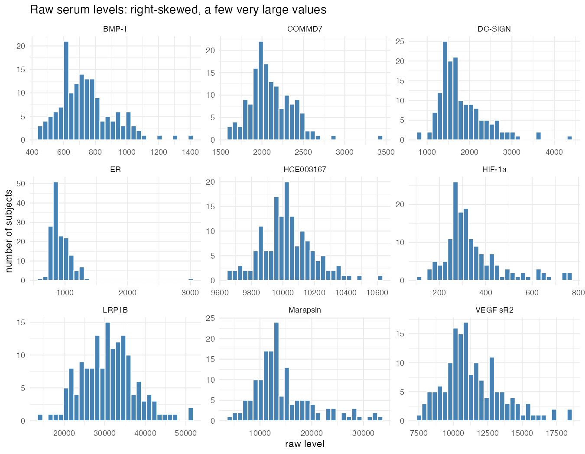
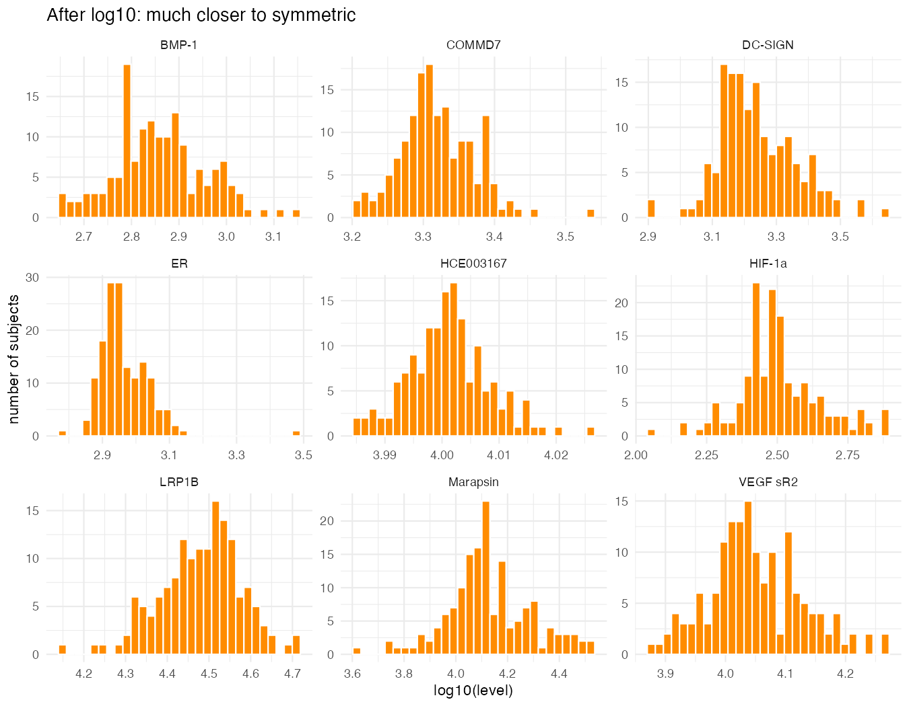
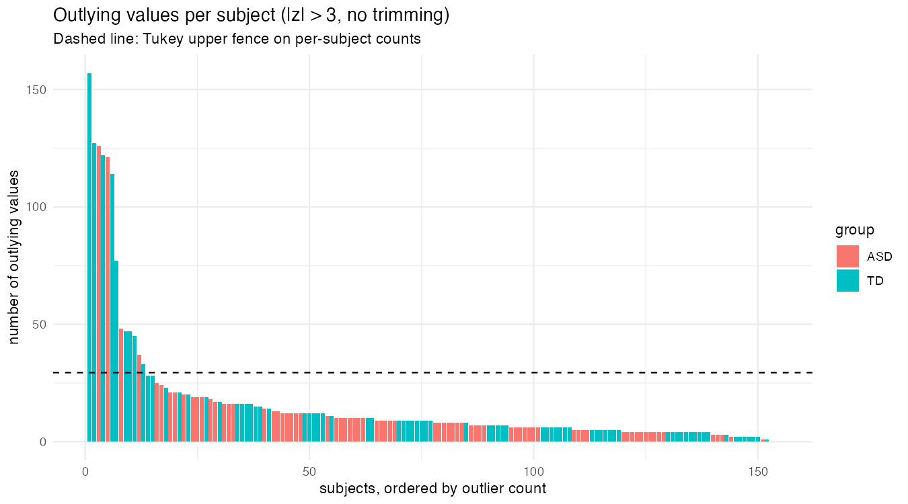
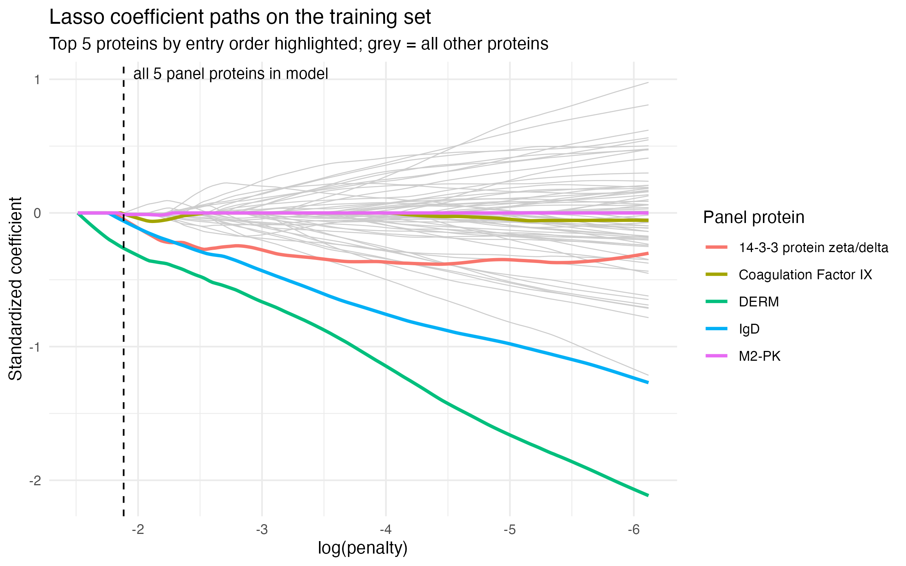

Use this as a template. Keep the headers and remove all other text. In all, your report can be quite short. When it is complete, render and then push changes to your team repository.

```{r}
# load any other packages and read data here
library(tidyverse)
```

## Abstract

Write a brief one-paragraph abstract that describes the contents of your write-up.

## Dataset

Write a brief data description, including: how data were obtained; sample characteristics; variables measured; and data preprocessing. This can be largely based on the source paper and should not exceed 1-2 paragraphs.

Data was obtained from serum samples from 76 boys with ASD and 78 typically developing (TD) boys, 18 months - 8 years of age. Participants were not randomly selected, instead enrolled based on specific clinical screening criteria. Participants with genetic, metabolic, or other concurrent physical, mental, or neurological disorders were excluded. TD subjects were excluded if they had any first- or second-degree relatives diagnosed with ASD.

1317 proteins were measured, with 192 of them failing quality control of the original study. Because the ones that failed quality control are unknown, we will be using all of them. Protein abundance data was normalized by taking log10 transform and then z-transformation. To deal with outliers, any values after transformation above 3 or below -3 were clipped to those values.

## Summary of published analysis

Summarize the methodology of the paper in 1-3 paragraphs. You need not explain the methods in depth as we did in class; just indicate what methods were used and how they were combined. If possible, include a diagram that depicts the methodological design. (Quarto has support for [GraphViz and Mermaid flowcharts](https://quarto.org/docs/authoring/diagrams.html).) Provide key results: the proteins selected for the classifier and the estimated accuracy.

After data collection and preprocessing, researchers combined 3 feature selection techniques.

1\. A random forest model was trained 1000 times. Each protein's importance was averaged over those runs, using MeanDecreaseGini (mean decrease in Gini Index). The 10 proteins with the highest averaged importance values were chosen from this method.

2\. T-tests with FDR \< 0.05 were conducted to find which proteins indicate a significant difference. The 10 proteins with the most highly significant t-test values were selected.

3\. A correlation approach was used to calculate each protein’s correlation with ADOS total scores (a measure of ASD severity). The 10 most highly correlated proteins were selected.

After finding the top 10 proteins from each method, they found 5 proteins that were in each method's top 10. Those were selected as the 5 proteins for the baseline model, leaving the other 13 proteins for investigation. They then trained a logistic regression model using an 80-20 train-test split, using AUC as the evaluation metric. This process was repeated 1000 times to suppress bias.

The 5 core proteins were MAPK14, IgD, DERM, EPHB2, and suPAR. 4 other proteins were added that raised the AUC: ROR1, GI24, elF-4H, and ARSB. Combining the 5 core proteins with the additional 4 proteins resulted in an AUC = 0.860±0.064, with a sensitivity = 0.833±0.118, and specificity = 0.846±0.118.

```{mermaid}
%%| label: fig-methods
%%| fig-cap: "Methodological design of the ASD protein classifier"
flowchart TD
    A[Data collection and preprocessing] --> B[Random forest x1000<br/>mean MeanDecreaseGini<br/>top 10 proteins]
    A --> C[t-tests, FDR < 0.05<br/>top 10 proteins]
    A --> D[Correlation with ADOS total score<br/>top 10 proteins]
    B --> E{Overlap of the three top-10 lists}
    C --> E
    D --> E
    E --> F[5 core proteins<br/>MAPK14, IgD, DERM, EPHB2, suPAR]
    E --> G[13 remaining proteins<br/>for further investigation]
    F --> H[Baseline logistic regression<br/>80/20 train-test split<br/>repeated 1000 times, AUC]
    G --> I[Add candidate proteins<br/>ROR1, GI24, eIF-4H, ARSB]
    H --> I
     I[Add each of the 13 proteins to the core, one at a time,<br/>keeping those that raise AUC] --> J[4 additive proteins<br/>ROR1, GI24, eIF-4H, ARSB]
   J --> K[Final 9-protein panel<br/>AUC 0.860 ± 0.064<br/>Sens 0.833 ± 0.118<br/>Spec 0.846 ± 0.118]
```

## Findings

Summarize your findings here. I've included some subheaders in a way that seems natural to me; you can structure this section however you like.

### Impact of preprocessing and outliers

### Impact of preprocessing and outliers

**Why log-transform?** Raw protein levels are strictly positive (minimum 12.9) and mostly right-skewed, with a few very large values (@fig-log). The median skewness across all 1,317 proteins is 2.26 on the raw scale and 0.83 after log10, and the share of proteins with skewness above 1 falls from 76% to 45%. Raw levels also have a spread that grows with the mean: the correlation between a protein's mean and its SD is 0.78 raw but 0.10 after log10. The log transform therefore pulls in the long right tail and puts proteins on a comparable scale, which better fits the roughly symmetric, equal-variance behavior that the t-tests assume and keeps a few extreme raw values from dominating means and SDs. The transform does not fully symmetrize every protein, since 45% still have skewness above 1. Ω¢

::: {#fig-log layout-ncol="2"}




Distributions of nine randomly sampled proteins before and after the log10 transform.
:::

**Outliers.** We removed the trimming step and defined an outlying value as a standardized value beyond ±3, the same cutoff used for trimming. This flags 2,379 of 202,818 values (1.2%), 83% of them on the high side. Under normality we would expect about 3.6 outlying values per subject; the median subject has 8.5. Outliers are concentrated in a few subjects rather than in particular proteins (no protein has more than 7 outlying values). Thirteen subjects exceed the Tukey upper fence on per-subject counts (about 29 outlying values) and together account for 46% of all outlying values (@fig-outliers). The most extreme are subjects 154 (157 outlying values), 108 (127), 9 (126), 121 (122), and 52 (121). Several of these have outliers almost entirely in one direction (subject 9 has 126 high and none low), which suggests a sample-level shift rather than protein-specific effects; we did not test this.

{#fig-outliers}

| Group | Subjects | Total outlying values | Mean per subject | Median per subject | Flagged subjects |
|------------|------------|------------|------------|------------|------------|
| ASD | 76 | 1,007 | 13.2 | 8.5 | 4 |
| TD | 78 | 1,372 | 17.6 | 8.5 | 9 |

: Outlying values by group.

TD subjects have more outlying values in raw counts (@tbl-outliers), but the medians are identical and the difference comes from a handful of extreme subjects. We found no statistical evidence that one group is more outlier-prone: the Wilcoxon rank-sum test on per-subject counts gives p = 0.82, a permutation test on mean counts gives p = 0.29, and a Fisher exact test on flagged subjects gives p = 0.25. Trimming at ±3 caps these values rather than removing the subjects, so the flagged subjects still contribute many capped values to every downstream analysis.

### Methodological variations

Task 3

### Improved classifier

**Baseline Results**

The in-class analysis selected 5 proteins for the panel (DERM, RELT, MRC2, IgD,     Cadherin-5) and achieved these metrics on the testing data: sensitivity: 0.812, specificity: 0.733, accuracy: 0.774, roc_auc: 0.883. 

**Methodology and Results**

To find a panel with the same number of proteins but with higher accuracy, we decided to use a LASSO approach to get a panel of 5 proteins. This approach sets many of the variable weights to 0 and uses a small but important subset of the features. We used lasso logistic regression (glmnet, 200-penalty path) fit on the training set only and took the top 5 proteins. Proteins were ranked by when they entered the lasso path. This led to a new protein panel (DERM, IgD, 14-3-3 protein zeta/delta, M2-PK, Coagulation Factor IX), where only DERM and IgD are shared between the two panels. 

```{r}
 
```

Testing this new panel using the same logistic regression as the in-class analysis, we achieved sensitivity 0.688; specificity 0.933; accuracy 0.806; roc_auc 0.933. Comparing the metrics, the true positive rate went down while the true negative rate went up compared to the baseline. This tradeoff came with an overall improvement to the roc_auc, 0.05 higher than the baseline. 

We also wanted to see if this method could achieve a simpler panel with comparable accuracy as well. Trying a smaller panel using the top 3 and top 4 proteins, we achieved results of  sensitivity: 0.562, specificity: 0.8, accuracy: 0.677, roc_auc: 0.8 and sensitivity: 0.5, specificity: 0.933, accuracy: 0.710, roc_auc: 0.825 respectively. Unfortunately, the roc_auc on these panels is not that comparable to the baseline. Finding a simpler panel that achieves similar results would need another method. 

**Limitations**

The accuracy increase seems like an improvement, but because of the small test size (31), it only differs from the baseline by 1 correct classification. The small test size also means that the other test metrics should be taken with some skepticism. The new panel scores higher than the previous panel in terms of roc_auc here, but testing with different splits could lead to different results. 

However, the in-class panel was selected using the full dataset (t-tests and a random forest on all subjects), including the subjects later used as the test set, so its test metrics are likely optimistic. Our lasso panel was selected using the training set only. The comparison is therefore conservative toward the new panel.
